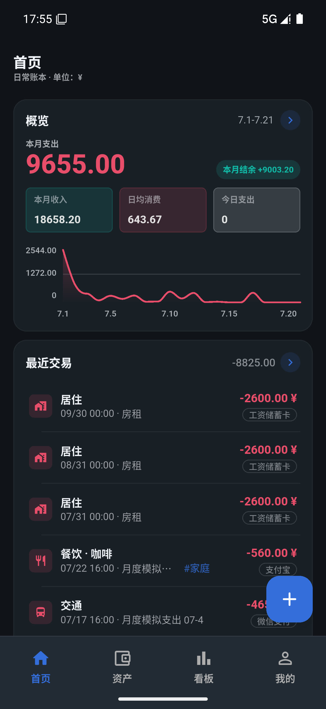
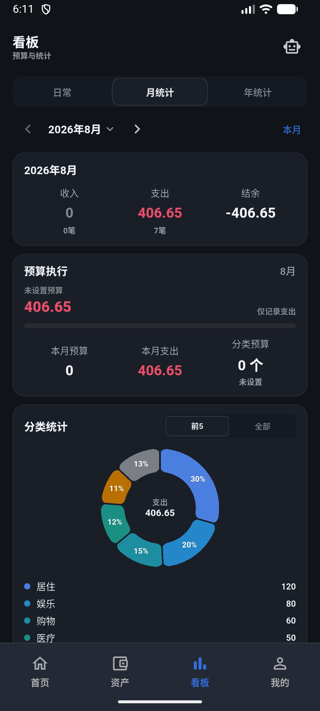
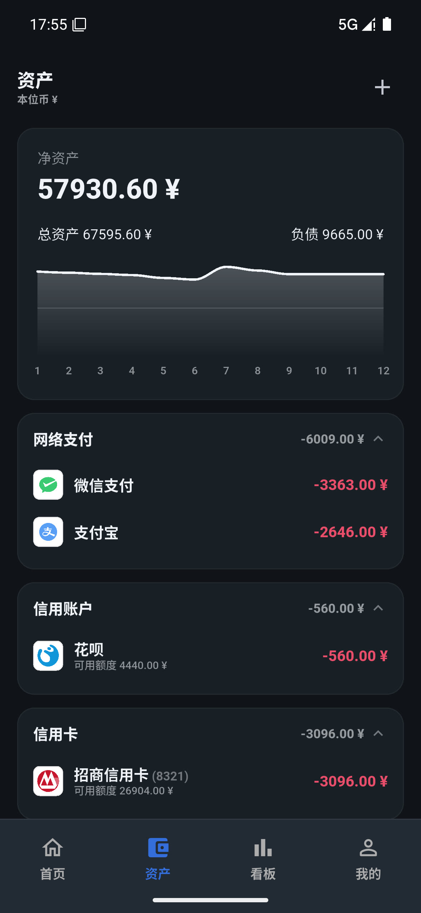

# 截图目录

下图为 2026-10-11 的界面示例，使用模拟器演示账目。当前导航顺序和看板标签见 [产品文档](../product/product.md#信息架构)。

| 首页 | 看板 | 资产 |
| --- | --- | --- |
|  |  |  |

更新界面后记得同步替换：在专用模拟器中用 `--flavor diagnostic` 启动演示账本，打开对应页面顶部，
确认模拟器为 1180×2556 / density 480（`adb shell wm size` / `wm density`），
`adb exec-out screencap -p > shot.png`，再转 JPEG 覆盖同名文件（如 `ffmpeg -i shot.png -q:v 3 home.jpg`）。
